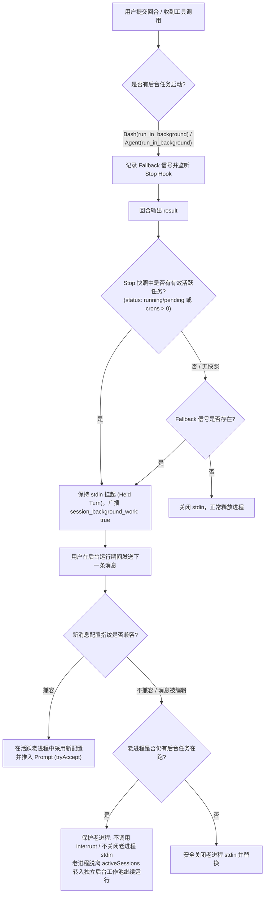

# Spec: Claude Subagent 与后台命令意外中断缺陷分析与修复方案

## 0. 复验结论（2026-09-23）

本文档的三处缺陷经 2026-09-23 证据复验（当日 3 个 session 转录取证 + Windows 事件日志 + 代码与 SDK 0.3.165 类型交叉核对）：

| 缺陷 | 复验结论 |
|---|---|
| 一（fallback 不认 subagent） | **成立**，且只是完整根因的一半；另一半是"回合内观察到的后台启动会被一份负快照否决"的判定优先级问题。两者均已修复（§0.4）。 |
| 二（追问指纹失配强杀老进程） | 代码路径属实，但当日 18 起中断**零证据**命中（死亡均为进程退出型，无 interrupt 痕迹、无编辑历史消息痕迹）。修法需"一个会话两个进程"的架构改动（两进程共享同一 provider session id 会写坏 transcript），风险大。**转已知限制，暂缓**（§0.5）。 |
| 三（快照未按 status 过滤） | **驳回**。SDK 类型注释明确 `background_tasks` 只含在途任务（"In-flight background work… **Empty array when nothing is in flight**"），已完成任务不会出现在列表里，`tasks.length > 0` 符合契约。其修法（只认 running/pending）还会把注释中的第三类在途状态（"running/pending **+ backgrounded**"）漏掉，反而引入新误杀。 |

### 0.1 当日真实死因分布（18 起）

- **13 起 orphan**（"No completion record… when the previous Claude Code process exited"）——Claude Code 进程本身退出，任务陪葬：
  - 两次**用户手动重启机器**（事件日志 1074：14:51:29、15:38:22，均在修 Docker/腾 C 盘期间）。两个不同 session 的进程在 15:38:06 / 15:38:22 相隔 16 秒同死，与第二次重启吻合。
  - 服务器进程被杀（`start-cloudcli.bat` 每次运行都 `Stop-Process -Force`）。一例构建任务父进程 16:39:57 被硬杀，子进程孤儿存活 11 分钟跑完，UI 永远收不到结果。
  - **机器/服务器死亡代码修不了**；CLI 自带的 orphan 扫描 + "Session restarted" 提示是兜底。
- **4 起网关错误**（推理网关 500 ×2、上游 429 限流 ×2）——外部问题。
- **1 起静默丢失**（无任何提示；当日 C 盘满，完成记录写丢可致同类现象，含 1 起误报）。
- **`[killed]` 标记 ×3**（后台 shell 派发后 8–12 秒被杀，发生在机器存活窗口内）——**hold 判定失败的直接铁证**，即 §0.2 的竞态。

### 0.2 代码根因：hold 判定被"过期的空快照"否决

时序：回合内派发后台任务 → 数秒后回合结束 → **Stop 快照拍摄时任务尚未在 CLI 侧注册完成** → 报 `background_tasks: []` → 原判定 `(hasSnapshot() ? snapshotOutstanding : backgroundBashStarted)` 中 `hasSnapshot()=true` 直接压过工具名 fallback → 判"无在途" → 关 stdin → CLI 收尾杀任务（shell 约 5 秒宽限后；subagent 最多 30 分钟）。

竞态解释了全部观察现象：

- "时好时坏、没规律" = 任务注册是否赶在快照前，纯时序；
- "标签有时出现" = 快照拍全时 hold 生效（同时证明快照通道在用户环境是通的）；
- Bash 和 subagent 都死 = Bash 的 fallback 被空快照压死，subagent 连 fallback 都没有。

### 0.3 原设计为何会犯这个错

`claude-background-work.ts` 原注释认为"subagent 几乎总在回合结束前完成，按名字标记会白挂进程"。该理由只对**前台** subagent 成立；`run_in_background: true` 的 subagent 按定义活过回合，正是 fallback 该覆盖的场景。且"快照优先"的优先级让一份可能滞空的快照拥有了否决亲眼所见的能力。

### 0.4 已实施修复（2026-09-23）

1. `server/modules/providers/list/claude/claude-background-work.ts`：
   - fallback 扩为 `Bash`/`Agent`/`Task`，仍只认显式 `run_in_background: true`（前台 subagent 不带该字段，不会误挂；字段存在性已在真实转录中验证）；
   - 判定改为 **（快照说有）OR（本回合观察到显式后台启动）**，本回合亲眼所见不再能被负快照否决；
   - 日志：竞态发生时一次性 warn（快照报空但本回合有启动）；每次 hold 决定打 info（含原因 `snapshot` / `observed-start`）。
   - 副作用：后台任务恰好在回合内跑完的罕见情形会多 hold 到下一个快照或 30 分钟静默上限——多挂一个空闲进程，远好过杀任务。
2. `server/index.ts`：启动（pid + port + 时间戳）与收到退出信号（SIGTERM/SIGINT）各打一行日志。force-kill 不经过该路径——**有无 shutdown 日志即区分优雅退出与被硬杀/崩溃**。
3. 测试：`claude-background-work.test.ts`（空快照 + 本回合 Bash/Agent 启动 → hold；无 hooks 时后台 Agent/Task → hold；前台仍 release）；`claude-subagent-survival.test.ts`（空快照竞态下后台 subagent 活过回合、追问复用进程、任务回报后释放）。

### 0.5 已知限制（原缺陷二，暂缓）

后台任务 hold 期间，若下一条消息**编辑了历史消息**（带 resume anchor）或**指纹失配**（切换非默认 effort / ultracode / 自定义端点 / 声明窗口不同的模型），老进程会被 `interrupt()` + 关 stdin，其上的后台工作随之被杀（shell 数秒后，subagent 最多 30 分钟）。

- 当日证据中未出现该死法；
- 修复需要"老进程脱离 activeSessions 独立存活、新进程另起"的架构：同一 app session 下两个进程共享同一 provider session id，transcript 会互相写坏，属大改；
- 与"首条消息 Edit ≈ 新开 session（wontfix，2026-09-11）"同精神：改历史 = 接受新进程；
- 触发时的可观察信号：服务器日志先打出 `Holding the process for outstanding background work (…)`，随后出现老进程 wind-down 的 orphan 提示。

---

## 1. 概述 (Overview)

在 CloudCLI 中，用户运行后台命令（如 `Bash(run_in_background: true)`）或启动子代理任务（Subagent，通过 `Agent`/`Task` 工具）时，经常出现任务未完成即被中断/终止的现象。

虽然此前仓库已引入基于 SDK Hook 快照的后台任务记账（`claude-background-work.ts`）与进程保持复用机制（`claude-turn-reuse.ts`），但在深层生命周期和边界条件的处理上仍存在 3 处关键断裂点，导致后台工作在特定时机被系统主动杀死或漏判。

---

## 2. 根因分析 (Root Cause Analysis)

### 2.1 缺陷一：Fallback 兜底信号不对称，完全忽略 Subagent

> **复验（2026-09-23）：成立，已随 §0.4 修复**（fallback 扩 Agent/Task + 判定改 OR）。
* **涉及文件**: [`server/modules/providers/list/claude/claude-background-work.ts`](file:///d:/code/opensource/claudecodeui/server/modules/providers/list/claude/claude-background-work.ts#L36-L44)
* **代码现状**:
  ```typescript
  function startsBackgroundBash(sdkMessage: unknown): boolean {
    const content = (sdkMessage as AnyRecord)?.message?.content;
    if (!Array.isArray(content)) return false;

    return content.some((block: AnyRecord) =>
      block?.type === 'tool_use' && block.name === 'Bash' && block.input?.run_in_background === true);
  }
  ```
* **问题原理**:
  1. 此兜底只检测 `Bash` 工具的 `run_in_background: true`。在 Claude Code 中，Subagent 通过 `Agent` 或 `Task` 工具启动，其参数同样支持 `run_in_background: true`。
  2. 当环境出现任何导致 Hook 快照不可用的情况（例如 SDK 初始化降级剔除 hooks、CLI 版本未携带 `background_tasks`、或 Hook 调用超时），`hasSnapshot()` 为 `false`，系统退化至 Fallback 信号。
  3. 由于 Fallback 无法识别 `Agent`/`Task`，`hasOutstandingWork()` 误判返回 `false`。
  4. 当前回合一旦收到 `result`，系统认为该会话已无任何后台任务，立即执行 `releasePromptStream()` 关闭 stdin。CLI 随后在短时间内清理退出，**Subagent 当场夭折**。

---

### 2.2 缺陷二：跨回合追问时，新老回合指纹失配导致老进程被强行杀死

> **复验（2026-09-23）：代码路径属实，当日证据零命中；转已知限制、暂缓**。见 §0.5。
* **涉及文件**:
  * [`server/modules/providers/list/claude/claude-runtime.provider.js`](file:///d:/code/opensource/claudecodeui/server/modules/providers/list/claude/claude-runtime.provider.js#L884-L909)
  * [`server/modules/providers/list/claude/claude-runtime.provider.js`](file:///d:/code/opensource/claudecodeui/server/modules/providers/list/claude/claude-runtime.provider.js#L359-L370)
* **代码现状**:
  ```javascript
  // claude-runtime.provider.js (行 884-909)
  const turnFingerprint = buildTurnSettingsFingerprint(sdkOptions);
  if (sessionKey()) {
    const reusableTurn = carriesResumeAnchor(options)
      ? null
      : claimHeldTurn(sessionKey(), turnFingerprint);
    const accepted = reusableTurn
      ? await reusableTurn.tryAccept(...)
      : null;
    if (accepted) {
      await accepted.settled;
      return;
    }
    // 复用失败时：
    getSession(sessionKey())?.releaseInput?.(); // 立即关闭老进程 stdin
  }

  // addSession (行 359-370)
  if (superseding) {
    supersededInstances.add(existing.instance);
    existing.instance.interrupt(); // 强制打断老 query 实例
    existing.releaseInput?.();
  }
  ```
* **问题原理**:
  1. 挂起进程（Held Turn）的复用依赖静态指纹 `buildTurnSettingsFingerprint`（包含 `cwd`, `effort`, `settings`, `baseUrl`, `apiKey`, `contextWindow`）。
  2. 若用户在后台任务运行期间发了新消息，且发生了配置差异（例如切换或自动解析了不同的 `effort`、工作目录变动），或用户编辑了历史消息导致携带 `resumeAnchorId`，`claimHeldTurn` 将判定不可复用（`reusableTurn` 为 `null`）。
  3. 一旦复用失败，代码立刻调用老会话的 `releaseInput()`，并在 `addSession` 中无条件执行 `existing.instance.interrupt()`。
  4. **这直接强杀正在运行后台 Subagent 或后台 Shell 的老进程**，造成跨回合操作对后台任务的致命破坏。

---

### 2.3 缺陷三：快照中未按任务运行状态过滤

> **复验（2026-09-23）：已驳回**——SDK 契约规定列表只含在途任务，其过滤法会引入新误杀。见 §0。
* **涉及文件**: [`server/modules/providers/list/claude/claude-background-work.ts`](file:///d:/code/opensource/claudecodeui/server/modules/providers/list/claude/claude-background-work.ts#L85-L97)
* **代码现状**:
  ```typescript
  const recordSnapshot = async (input: AnyRecord): Promise<AnyRecord> => {
    const tasks = input?.background_tasks;
    const crons = input?.session_crons;
    if (!Array.isArray(tasks) && !Array.isArray(crons)) {
      return {};
    }

    snapshotOutstanding = (Array.isArray(tasks) && tasks.length > 0)
      || (Array.isArray(crons) && crons.length > 0);
    return {};
  };
  ```
* **问题原理**:
  根据 SDK 类型规范，`BackgroundTaskSummary` 包含 `status: string`（可能为 `running`, `pending`, `completed`, `stopped`, `failed`）。仅判断 `tasks.length > 0` 会将非活跃/已终止的任务误判为仍在进行，且对已完成任务从快照中移除的时机敏感，缺乏鲁棒性。

---

## 3. 架构设计与修复方案 (Architecture & Remediation)



### 3.1 改造一：扩展 Fallback 信号判定
在 `claude-background-work.ts` 中重构检测函数，覆盖 `Agent`、`Task` 以及 `Bash`：
```typescript
function startsBackgroundWork(sdkMessage: unknown): boolean {
  const content = (sdkMessage as AnyRecord)?.message?.content;
  if (!Array.isArray(content)) {
    return false;
  }

  return content.some((block: AnyRecord) => {
    if (block?.type !== 'tool_use') return false;
    const toolName = block.name;
    const isBackgroundTool = toolName === 'Bash' || toolName === 'Agent' || toolName === 'Task';
    return isBackgroundTool && block.input?.run_in_background === true;
  });
}
```

### 3.2 改造二：精细化过滤快照状态
在 `recordSnapshot` 中增加对 `status` 的有效性校验：
```typescript
const isTaskActive = (task: AnyRecord): boolean => {
  const status = typeof task.status === 'string' ? task.status.toLowerCase() : '';
  return status === 'running' || status === 'pending';
};

snapshotOutstanding = (Array.isArray(tasks) && tasks.some(isTaskActive))
  || (Array.isArray(crons) && crons.length > 0);
```

### 3.3 改造三：老进程后台任务保护与生命周期解耦
在 `claude-runtime.provider.js` 中：
1. **取消不可复用时的无条件 `releaseInput`**:
   当 `reusableTurn` 为 `null` 或 `tryAccept` 失败时，首先检查该老会话是否持有后台未完成工作（`chatRunRegistry.hasBackgroundWorkOutstanding(sessionId)` 或内部 `heldForBackgroundWork`）。
   - 若持有：**严禁调用 `releaseInput()`**，**严禁在 `addSession` 中对其执行 `interrupt()`**。
   - 老进程的 stdin 保持开放，继续受 `idleReleaseTimer` 与静默超时保护，等待后台任务执行完毕并触发通知。
   - 新回合在新的独立 query 实例中正常启动。

---

## 4. 验证计划 (Verification Plan)

### 4.1 单元测试补充
1. **Fallback 场景覆盖**:
   在 `claude-background-work.test.ts` 中新增测试用例：
   * 在无 Hook 支持的前提下，调用 `toolUse('Agent', { run_in_background: true })`，验证 stdin 是否成功保持不关闭。
   * 调用 `toolUse('Task', { run_in_background: true })`，验证 stdin 是否成功保持不关闭。
2. **快照状态过滤测试**:
   验证传入 `background_tasks: [{ status: 'completed' }]` 时，系统能正确识别无在途任务并正常关闭。
3. **不可复用追问保护测试**:
   在 `claude-subagent-survival.test.ts` 中模拟：
   * 回合一启动 Subagent 并挂起；
   * 回合二携带不同 `effort` 或编辑锚点发起请求，验证新 Query 启动的同时，老 Query 的 `interruptCount` 为 0，且老 Query 的 `promptStreamClosed` 保持 `false`。

### 4.2 验收基准 (Acceptance Criteria)
* [ ] 启动后台 Subagent 后，在无任何操作的情况下，进程可持续保持活跃直至任务完成。
* [ ] 启动后台 Subagent 或后台 Bash 后，在不同参数（切换模型、修改 effort）下发送新消息追问，原后台任务不受影响，继续执行并在完成后正常发出系统通知。
* [ ] 全量通过 `npm run test`（`server/**/*.test.ts`）。
